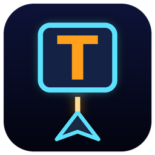

# TypeStrike



Версия **1.0.0**. Версия задаётся в `TypeStrike/TypeStrike.csproj` (`<Version>`) и показывается в меню и заголовке окна.
Иконка перерисовывается скриптом `tools/make_icon.py` (нужен Pillow).

Космический тренажёр скоростной печати на **WPF / .NET 8** с геймплеем в духе [zty.pe](https://zty.pe/).

Сверху на ваш корабль летят вражеские корабли, на каждом написано слово. Печатайте слова, чтобы сбивать их:
каждая верная буква — выстрел, последняя буква — взрыв.

## Запуск

Нужны Windows и [.NET 8 SDK](https://dotnet.microsoft.com/download/dotnet/8.0).

```bash
dotnet run --project TypeStrike -c Release
```

Или откройте `TypeStrike.sln` в Visual Studio 2022 и нажмите F5.

## Уроки слепой печати

Режим «Уроки» построен по классической методике онлайн-тренажёров (Ratatype, «Соло на клавиатуре»):

- **Основной ряд.** Пальцы лежат на ФЫВА — ОЛДЖ (ASDF — JKL;), на А/О (F/J) есть выступы.
- **Буквы добавляются постепенно.** Каждый урок — 1–2 новые буквы:
  - русский (16 уроков): `АО → ВЛ → ЫД → ФЖ → ПР → КЕ → НГ → МИ → ТЬ → УШ → СБ → ЦЩ → ЧЮ → ЯЭ → ЙЗХЪ → Ё`;
  - английский (14 уроков): `FJ → DK → SL → A → GH → EI → RU → TY → WO → QP → NV → MC → BX → Z`.
- **Сначала упражнения, потом слова.** Урок — 4 волны. Первая волна — сочетания новых букв («ааа», «аоа», «вол»), дальше — настоящие слова только из изученных букв. Если слов с новыми буквами хватает, тренируются именно они.
- **Скорость не важна — нужна точность 98–100%.** Зачёт: ★ 98%, ★★ 99%, ★★★ 100%. В уроке враги медленнее, а столкновение не уничтожает корабль, поэтому спешить незачем. На экране крупно показана точность, а не WPM.
- **Новая буква — только после стабильного результата.** Урок освоен после 3 зачётов подряд, если скорость в них стабильна (худшая не ниже 80% от лучшей). Только тогда открывается следующий урок. Прогресс показан точками «освоение ●●○».
- **Советы** по посадке, ритму и режиму занятий показываются перед уроком и в итогах.

### Настройки (`F2` в меню)

- **Размер букв:** обычные, крупные (по умолчанию) или очень крупные — на врагах, в строке слова и на клавишах.
- Подсказка клавиатуры и пальцев, звук.
- **Камера:** включение, выбор камеры (№ 1–3), предпросмотр с рамками лица и глаз,
  полоса наклона головы с меткой порога, ползунок чувствительности, учёт глаз,
  схема «куда вы смотрите», калибровка взгляда по движущейся точке, «калибровать в начале каждой игры».
  Калибровка сохраняется, так что её можно сделать один раз.

Все настройки, выбранный язык, режим и сложность запоминаются в `%AppData%\TypeStrike\settings.json`.
По умолчанию — **русский язык и уроки слепой печати**.

### Сохранение уровня

- **Уроки:** текущий урок, звёзды, история попыток и освоенные буквы сохраняются автоматически.
- **Свободная игра:** после каждой пройденной волны уровень сохраняется (для каждого набора слов и сложности).
  В меню и в итогах появляется кнопка «Продолжить с волны N» — игра продолжится с той же волны и с тем же счётом.

### Камера: отслеживание взгляда (эксперимент)

Веб-камера следит, куда вы смотрите (OpenCV, каскады Хаара):

1. В каждом кадре находятся лицо, глаза и **радужка целиком** — тёмный круг в разрезе век
   на белом фоне белка (искать точный центр зрачка на веб-камере слишком ненадёжно).
   Признаки взгляда по каждому глазу:
   - положение радужки в разрезе глаза по горизонтали и вертикали;
   - **баланс белка** — сколько белка видно слева и справа от радужки (поворот глаз влево/вправо);
   - **открытость** — видимая высота радужки к её ширине: верхнее веко срезает радужку, когда смотрят вниз;
   - а также положение и размер лица в кадре.
2. **Калибровка по движущейся точке** (~20 секунд): оранжевая точка облетает 9 позиций окна, вы следите за ней глазами.
   По записанным кадрам подбирается модель «признаки → точка на экране» (гребневая линейная регрессия).
   Калибровка сохраняется; запустить её можно в настройках, по `F5` в игре или на паузе,
   а при включённой опции — перед каждой игрой.
3. Взгляд «не на экране»: точка взгляда ушла за границы окна (обычно вниз — на клавиатуру),
   голова заметно опущена, открытые глаза пропали или лицо исчезло из кадра.
4. **Со второй волны** взгляд мимо экрана ставит игру на паузу с анимацией
   «Поднимите глаза на экран». Игра продолжается сама, когда взгляд держится на экране секунду.
   На первой волне — только подсказка. В итогах — сколько раз взгляд уходил с экрана.

5. **Взгляд на цели.** Камера сравнивает точку взгляда с положением атакуемого врага
   (текущая цель или ближайший враг — корабль и подпись под ним). Когда взгляд следит за ним,
   вокруг врага появляется зелёное кольцо.
6. **Подсказка уходит вниз.** Пока взгляд уверенно следит за целью (дольше 1,5 с),
   нижнее окно с клавиатурой и пальцами медленно уезжает вниз за край окна — примерно за 12 секунд.
   Оно быстро возвращается, когда:
   - следующая буква **новая** — буква текущего урока, пока она не набрана верно 15 раз,
     или любая буква, которая в этой игре набиралась меньше 3 раз;
   - была **ошибка** (на 2,5 с, а для буквы, на которой ошиблись, — на 10 с);
   - взгляд ушёл с экрана.

   Отключается в настройках («Прятать подсказку клавиатуры…»). Без камеры подсказка видна всегда.
7. **Подстройка калибровки во время игры.** При верном нажатии буквы цели вы почти наверняка
   смотрите на неё — признаки глаз в этот момент и положение цели становятся ещё одной точкой калибровки.
   Каждые 20 таких точек модель пересчитывается по калибровочным точкам и последним 300 игровым
   (игровые — с меньшим весом). Точки, где модель промахнулась больше чем на 45% экрана, отбрасываются
   (вы смотрели не на цель). Так модель догоняет, если вы пересели или изменился свет.
   Подстроенная калибровка сохраняется в конце игры; новая калибровка по точке начинает всё заново.
   Отключается в настройках («Подстраивать калибровку во время игры»).

В настройках видно, куда модель «думает», что вы смотрите (точка на схеме экрана), и показатели лица и глаз.
Кадры обрабатываются только в памяти и никуда не сохраняются.
Точность у обычной веб-камеры скромная (порядка 10–20% экрана): её хватает,
чтобы отличить «смотрю на экран» от «смотрю на клавиатуру», но не для точного указания точки.

### Подсказка пальцев

Под игровым полем (отключается в меню):

- **строка слова** — текущая цель, напечатанные буквы приглушены, следующая выделена цветом пальца;
- **экранная клавиатура** с цветовыми зонами пальцев; нужная клавиша подсвечивается;
- **руки** с подсвеченным пальцем и подпись вроде «К — левый указательный».

## Как играть

| Клавиша       | Действие                                                         |
|---------------|------------------------------------------------------------------|
| буквы         | первая буква захватывает ближайшего врага с таким началом слова |
| `Enter`       | ЭМИ-импульс: отбрасывает врагов и уничтожает мини-корабли рядом |
| `Backspace`   | отпустить текущую цель                                           |
| `Esc`         | пауза                                                            |

- Пока цель захвачена, засчитываются только буквы её слова; ошибка сбрасывает комбо.
- Каждые 20 верных нажатий подряд увеличивают множитель очков (до ×5).
- Волна без единой ошибки приносит бонус.
- Каждая 5-я волна — флагман с очень длинным словом.
- Буква «ё» засчитывается и при вводе «е».

### Враги

| Тип              | Особенности                                         |
|------------------|-----------------------------------------------------|
| Дрон (голубой)   | обычное слово, летит прямо на вас                   |
| Дротик (жёлтый)  | короткое слово, быстрый, летит зигзагом              |
| Носитель (фиолетовый) | длинное слово, медленный, выпускает мини-корабли |
| Мини-корабль (красный) | 2–3 буквы, очень быстрый                      |
| Флагман (розовый) | очень длинное слово, выпускает мини-корабли пачками |

### Настройки

- **Слова:** английские, русские или свой `.txt`-файл (слова через пробел или по строкам).
  Раскладка клавиатуры переключается автоматически, если она установлена в системе.
- **Сложность:** лёгкая (медленно, 3 щита, 2 ЭМИ), нормальная (2 щита), хардкор (быстро, одно столкновение — конец).
- Рекорды хранятся отдельно для каждого набора слов и сложности в `%AppData%\TypeStrike\scores.json`.
- После игры показываются скорость (WPM), точность, макс. комбо и буквы, на которых вы чаще ошибались.

## Устройство кода

```
TypeStrike/
├── App.xaml               стили (неоновые кнопки, переключатели)
├── MainWindow.xaml(.cs)   меню, пауза, итоги, ввод с клавиатуры, игровой цикл
├── Game/
│   ├── GameEngine.cs      логика: волны, враги, прицеливание, пули, ЭМИ, очки
│   ├── GameView.cs        отрисовка через DrawingContext (звёзды, корабли, частицы, HUD)
│   ├── KeyboardHint.cs    подсказка: слово, клавиатура с зонами пальцев, руки
│   ├── KeyboardLayout.cs  раскладки ЙЦУКЕН / QWERTY и закрепление клавиш за пальцами
│   ├── Lessons.cs         уроки, упражнения, отбор слов, советы
│   ├── AppSettings.cs     настройки и калибровка камеры в JSON
│   ├── Entities.cs        сущности: враг, пуля, частица, кольцо, звезда
│   ├── WordBank.cs        словари и выбор слов (без повторов первых букв на экране)
│   ├── SoundEngine.cs     синтез ретро-звуков в WAV и воспроизведение
│   └── ScoreStore.cs      рекорды, сохранённые уровни, звёзды, история попыток и освоение уроков
├── Camera/
│   ├── GazeTracker.cs     веб-камера: лицо, глаза, радужка в разрезе век, белок, оценка взгляда
│   ├── GazeModel.cs       модель «признаки → точка на экране» (гребневая регрессия)
│   ├── CalibrationRoutine.cs  сценарий калибровки по движущейся точке
│   └── *.xml              каскады Хаара OpenCV (лицо, глаза)
├── Assets/                иконка программы (.ico и .png)
└── Words/                 встроенные словари en.txt и ru.txt
tools/make_icon.py         рисует иконку
```

Игровой цикл работает на `CompositionTarget.Rendering`: каждый кадр движок обновляется
с реальным `dt`, а `GameView` перерисовывается.
