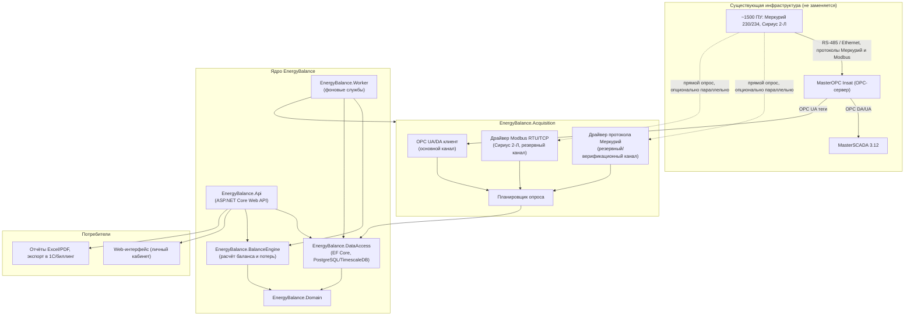

# Архитектура системы EnergyBalance

## 1. Обзор

Система построена по слоистой (layered) архитектуре с чётким разделением:

- **Domain** — модель предметной области, не зависит ни от чего;
- **DataAccess** — EF Core / PostgreSQL, зависит только от Domain;
- **Acquisition** — сбор данных (OPC UA к MasterOPC/MasterSCADA + прямые драйверы Меркурий/Modbus), зависит от Domain и DataAccess;
- **BalanceEngine** — расчёт баланса, зависит только от Domain (чистая логика, легко тестируется);
- **Api** — ASP.NET Core Web API, зависит от всех перечисленных;
- **Worker** — фоновые службы опроса и расчёта, зависит от Acquisition, BalanceEngine, DataAccess.



## 2. Каналы сбора данных

### 2.1. Основной канал — OPC UA/DA к MasterOPC/MasterSCADA

MasterSCADA 3.12 и MasterOPC Insat уже опрашивают все 1500 приборов учёта. Дублировать этот опрос нецелесообразно как основной режим — вместо этого `EnergyBalance.Acquisition.OpcIntegration.MasterOpcClient` подключается как OPC-клиент к серверу (MasterOPC поддерживает OPC DA; современные версии/шлюзы — OPC UA через встроенный или сторонний DA-UA Wrapper) и читает уже опрошенные теги: текущие показания, профиль нагрузки, статусные биты.

Преимущества: не требует нового физического подключения к линиям RS-485, использует уже настроенный и проверенный опрос MasterSCADA.

### 2.2. Резервный / верификационный канал — прямой опрос

Для критичных точек учёта (коммерческих границ балансовых групп) реализованы независимые драйверы:

- **`MercuryProtocolClient`** — протокол «Меркурий» (запрос-пароль, чтение массивов показаний, профиля нагрузки, CRC16). Актуален для Меркурий 230 и 234 (совместимые системы команд).
- **`SiriusModbusClient`** — Modbus RTU (через `NModbus`) для Сириус 2-Л, чтение по карте регистров.

Оба драйвера реализуют единый интерфейс `IMeterDataSource`, что позволяет `PollingScheduler` работать с любым источником одинаково и легко добавлять новые протоколы (СЭТ-4ТМ, Энергомера и т.д.) без изменения ядра.

### 2.3. Сверка каналов

Там, где точка учёта опрашивается одновременно по обоим каналам, `ReadingReconciliationService` сравнивает значения и создаёт событие `Alarm`, если расхождение превышает заданный порог (по умолчанию 0,5%) — это защищает от искажений на уровне SCADA-конфигурации (неверный масштаб тега, залипание архива и т.п.).

## 3. Расчёт баланса

`BalanceEngine` работает исключительно с доменными объектами и не знает про источники данных — это чистая, легко тестируемая логика:

1. `BalanceGroupResolver` строит дерево балансовых групп и топологически сортирует его (от листьев к корню).
2. `BalanceCalculator` для каждой группы суммирует показания точек-«прихода» и точек-«расхода» (с учётом коэффициентов трансформации и знака), вычисляет фактические потери и сравнивает с нормативом через `LossCalculator`.
3. Результат каждого расчёта сохраняется как **новая версия** `BalanceCalculationResult` — история не перезаписывается, что необходимо для трассируемости коммерческих расчётов.

## 4. Хранение данных

- PostgreSQL как основная СУБД.
- Таблицы `LoadProfileReading` (профиль нагрузки, наибольший объём) проектируются как **hypertable TimescaleDB** (или партиционируются по месяцам штатными средствами PostgreSQL), чтобы выдержать ~5 лет истории по 1500 точкам с получасовым интервалом.
- Остальные сущности (НСИ, результаты баланса, журналы) — обычные реляционные таблицы через EF Core.

## 5. Развёртывание

Три развёртываемых артефакта: `EnergyBalance.Api`, `EnergyBalance.Worker`, PostgreSQL — упаковываются в Docker-контейнеры и разворачиваются через `docker-compose` на сервере в контуре учёта (см. `docker-compose.yml` в корне репозитория). Прямой опрос приборов (COM-порты/Ethernet-шлюзы) выполняется процессом `Worker`, который должен иметь сетевой/локальный доступ к соответствующим портам.

## 6. Структура решения (solution)

```
src/
  EnergyBalance.Domain/        — сущности и перечисления предметной области
  EnergyBalance.DataAccess/    — EF Core DbContext, конфигурации, репозитории
  EnergyBalance.Acquisition/   — OPC-клиент, драйверы Меркурий/Modbus, планировщик опроса
  EnergyBalance.BalanceEngine/ — расчёт баланса и потерь
  EnergyBalance.Api/           — Web API
  EnergyBalance.Worker/        — фоновые службы (опрос, расчёт по расписанию)
tests/
  EnergyBalance.Tests/         — юнит-тесты расчётного ядра и протокольных утилит (CRC и т.п.)
```
